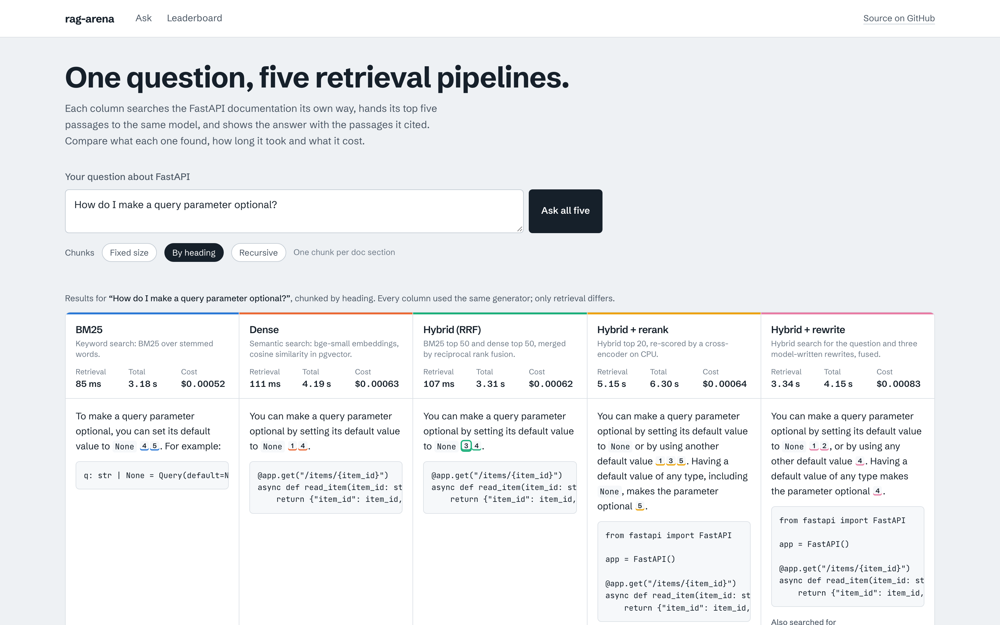
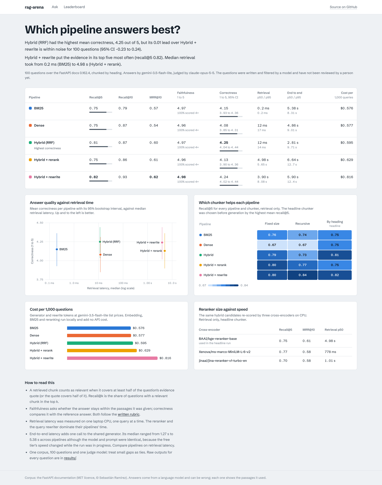
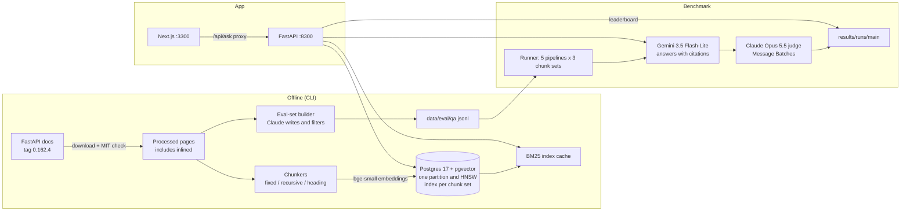

# rag-arena

Five retrieval pipelines answer the same questions over the FastAPI docs, and a benchmark
measures which one finds the evidence, answers correctly, and at what latency and cost.

<!-- Screenshot placeholder: swap in a short screen recording of a question running once a
     public demo is deployed. The images below are real screenshots taken with headless
     Playwright (`make screenshots`). -->



rag-arena is two things:

- **A benchmark.** BM25, dense embeddings, hybrid search with reciprocal rank fusion, hybrid
  plus a cross-encoder reranker, and hybrid plus LLM query rewriting, each run over three
  chunking strategies, scored on 100 questions with retrieval metrics, an LLM judge, latency
  percentiles and cost per 1,000 queries. Every raw output is committed in
  [`results/`](results/).
- **A playground.** A Next.js app where you ask a question and see every pipeline's answer side
  by side with the passages it cited, its latency and its cost, plus a leaderboard page with the
  benchmark tables and charts.

## Results

All numbers below come from the committed run in [`results/runs/main`](results/runs/main)
(raw records for every question, plus [`summary.json`](results/runs/main/summary.json)).
100 questions, chunked by heading (picked by the rule in [Protocol](#protocol)), answers by
`gemini-3.5-flash-lite`, judged by `claude-opus-5-5`. Faithfulness and correctness are means
on a 1 to 5 scale.

| Pipeline | Recall@5 | Recall@10 | MRR@10 | Faithfulness | Correctness | Retrieval p50 / p95 | End-to-end p50 / p95 | Cost per 1k queries |
| --- | ---: | ---: | ---: | ---: | ---: | ---: | ---: | ---: |
| BM25 | 0.75 | 0.79 | 0.57 | 4.97 | 4.15 | 0.2 / 0.2 ms | 5,382 / 8,307 ms | $0.576 |
| Dense | 0.75 | 0.87 | 0.54 | 4.96 | 4.08 | 12 / 17 ms | 4,857 / 9,010 ms | $0.577 |
| Hybrid (RRF) | 0.81 | 0.87 | 0.60 | 4.97 | 4.25 | 12 / 14 ms | 2,811 / 9,709 ms | $0.595 |
| Hybrid + rerank | 0.75 | 0.86 | 0.61 | 4.96 | 4.13 | 4,984 / 5,649 ms | 6,639 / 12,674 ms | $0.629 |
| Hybrid + rewrite | 0.82 | 0.93 | 0.62 | 4.98 | 4.24 | 3,898 / 8,080 ms | 5,905 / 12,426 ms | $0.816 |

**Winner: hybrid search with reciprocal rank fusion, by a nose.** Under the rule fixed before
the run (highest mean correctness), Hybrid (RRF) wins with 4.25 out of 5 (95% CI 4.04 to
4.44), and 88% of its answers scored 4 or 5. But the lead is not real at this sample size:
Hybrid + rewrite scored 4.24, and on the same questions the winner's lead over it is 0.01
(paired 95% CI -0.23 to 0.24). Its leads over BM25 (0.10), dense (0.17) and the reranker
(0.12) also have intervals that include zero. What the data does support is narrower:

- **Fusion finds more evidence than either retriever alone.** BM25 and dense each put the
  evidence in their top five for 75 of 100 questions, but not the same 75: 14 questions only
  BM25 found and 14 only dense found. Hybrid found 81. Against BM25 that is +0.06 recall@5
  (paired 95% CI 0.01 to 0.12), at 12 ms per query and no model call.
- **Answer quality tracks retrieval.** When a pipeline had the evidence in its top five,
  its answers averaged 4.43 to 4.60; when it did not, 2.72 to 3.39. Faithfulness sat at 4.96
  to 4.98 for every pipeline and every answer scored 4 or 5 on it: the generator stays within
  its passages and says so when they fall short (5% to 9% abstentions), so misses show up as
  incomplete answers rather than invented ones.
- **Query rewriting has the best recall but did not buy better answers.** It reached recall@5
  0.82 and recall@10 0.93 (the best of all), and 91% of its answers scored 4 or 5, but its mean
  correctness tied plain hybrid while adding a model call: 3.9 s median retrieval and 37% more
  cost per 1,000 queries ($0.816 against $0.595).
- **The cross-encoder hurt on these chunks.** Re-scoring hybrid's top 20 with
  `bge-reranker-base` lowered recall@5 on heading chunks from 0.81 to 0.75 and cost about 5 s
  per query on CPU. On fixed-size chunks the same reranker lifted MRR@10 from 0.59 to 0.64.
  This was not investigated; one untested guess is the heading path prepended to each chunk,
  which the reranker also sees. The two small cross-encoders took 0.8 to 1.0 s instead of
  5.0 s and were no better than hybrid alone.

So for documentation search like this, plain hybrid with RRF is the pick: as good as anything
measured here, about 12 ms per query, and the cheapest of the hybrids. Add rewriting only if
recall@10 matters more to you than 4 seconds and a 37% higher bill.

### Chunker ablation

Recall@5 / MRR@10 for every pipeline on every chunker (retrieval only; generation and judging
ran on the headline chunker).

| Pipeline | Fixed size | Recursive | By heading | Retrieval p50 (heading) |
| --- | ---: | ---: | ---: | ---: |
| BM25 | 0.76 / 0.57 | 0.74 / 0.56 | 0.75 / 0.57 | 0.2 ms |
| Dense | 0.67 / 0.51 | 0.67 / 0.51 | 0.75 / 0.54 | 12 ms |
| Hybrid (RRF) | 0.79 / 0.59 | 0.73 / 0.57 | 0.81 / 0.60 | 12 ms |
| Hybrid + rerank (bge-reranker-base) | 0.80 / 0.64 | 0.77 / 0.61 | 0.75 / 0.61 | 4,984 ms |
| Hybrid + rewrite | 0.80 / 0.66 | 0.84 / 0.60 | 0.82 / 0.62 | 3,898 ms |
| Hybrid + rerank (MiniLM-L6) | 0.73 / 0.55 | 0.72 / 0.53 | 0.77 / 0.58 | 778 ms |
| Hybrid + rerank (Jina turbo) | 0.79 / 0.56 | 0.72 / 0.55 | 0.70 / 0.58 | 1,007 ms |
| Mean recall@5 of the five pipelines | 0.764 | 0.750 | 0.776 | |

Chunking by heading won the pre-registered rule, narrowly. Its clearest effect is on dense
retrieval, from 0.67 to 0.75 recall@5: prepending the heading path gives the embedding the
section's context. BM25 barely moves between chunkers (0.74 to 0.76).

### Latency and cost

- Retrieval latency is what each pipeline controls: 0.2 ms for BM25, 12 ms for dense and
  hybrid, 3.9 s for rewriting (one model call) and 5.0 s for the reranker (CPU inference),
  medians on an Apple silicon laptop.
- End-to-end latency adds one call to the shared generator, and here it mostly measures the
  Gemini free tier, not the pipelines. The free tier allows 500 requests a day for this model,
  so generation ran over two days: the first 220 answers (mostly BM25 and dense) had a median
  generation time of 5.5 s on 10 November, the remaining 280 had 1.4 s on 11 November. Same
  model, same prompt. Compare pipelines on retrieval latency.
- Cost per 1,000 queries is $0.58 to $0.82 at Gemini list prices. About two thirds of it is
  the roughly 1,350 input tokens of the five passages; rewriting adds one small extra call.

### Caveats

- **100 questions** give confidence intervals of about ±0.2 on mean correctness; read smaller
  gaps as ties. **One corpus**: technical docs full of code, where keyword search is strong.
- **The questions were written by a model** (Claude Opus 5.5), each from a single section,
  filtered by the same model and not reviewed by a person. The judge is the same model family,
  so it grades answers against reference answers its own family wrote. The generator is a
  different family, so the judge is never grading its own answers.
- **Relevance is span overlap with one gold passage.** A chunk from another page that also
  answers the question counts as a miss, so recall is a lower bound. Four questions were missed
  by all five pipelines in the top 10.
- **LLM-as-judge** scores are not human ratings. The rubric is in
  [`docs/rubric.md`](docs/rubric.md); every judgment, with its reasoning, is in
  [`results/runs/main/judge.jsonl`](results/runs/main/judge.jsonl).
- **Generation is not deterministic**: the generator runs at its default temperature with a
  fixed seed, so a re-run will differ slightly.

Anthropic spend for the whole project, from
[`results/spend/anthropic.jsonl`](results/spend/anthropic.jsonl): $5.92 (eval-set writing
$0.71, filtering $0.45, judging $4.76 including ten smoke-test judgments, development $0.003).
Gemini usage stayed on the free tier.



## Architecture



## How it works

### Corpus

The English FastAPI documentation (`docs/en/docs/**/*.md`) at release tag `0.162.4`, commit
`e10178c`. FastAPI is MIT-licensed; `rag-arena corpus download` reads `LICENSE` at that tag and
stops if it is not MIT. Attribution and the full processing notes are in
[`data/SOURCE.md`](data/SOURCE.md).

The download keeps the docs, the code samples they include and the licence. Processing inlines
included code samples (much of the docs' content lives in them), strips heading anchors into
metadata so each chunk can link to the live page, and skips generated pages: the 736 KB
release notes, the API reference stubs and a few non-documentation pages. The result is 126
pages and 975,860 characters. `data/manifest.json` records a sha256 per page so a fresh
download can be verified with `rag-arena corpus verify`.

### Chunkers

All chunkers return character offsets into the processed page, so a chunk is always an exact
slice of the text and relevance can be judged by span overlap whatever the chunker.

| Chunker | Rule | Chunks | Mean size |
| --- | --- | ---: | ---: |
| `fixed` | 1,200-character windows, 200 overlap, snapped to whitespace | 1,014 | 1,130 chars |
| `recursive` | Split on headings, blank lines, lines, sentences, spaces; merge up to 1,200 | 1,127 | 864 chars |
| `heading` | One chunk per section; short intros merge into their first subsection; long sections split recursively; the heading path is prepended to the indexed text | 1,332 | 730 chars |

### Retrieval pipelines

| Pipeline | What it does |
| --- | --- |
| BM25 | `bm25s` (Lucene variant, k1 = 1.5, b = 0.75) with a Snowball stemmer, NLTK stopwords and snake_case splitting, built from the chunk rows in Postgres |
| Dense | `BAAI/bge-small-en-v1.5` via fastembed on CPU (384 dimensions), cosine search in pgvector. Queries get BGE's retrieval instruction, which fastembed does not add |
| Hybrid | BM25 top 50 and dense top 50 fused with reciprocal rank fusion, k = 60 |
| Hybrid + rerank | Hybrid top 20 re-scored by `BAAI/bge-reranker-base`, a cross-encoder, on CPU |
| Hybrid + rewrite | The generator model writes three rewrites (the question in the docs' terms, a keyword query, a sentence phrased like the answer); BM25 and dense run for the original and each rewrite, and all eight lists are fused with RRF |

Each pipeline returns its top 10. The top 5 go to the same generator,
`gemini-3.5-flash-lite` with minimal thinking, under the same prompt: answer only from the
numbered passages, cite them as `[n]`, and say so when the passages do not contain the answer.

### Eval set

100 questions in [`data/eval/qa.jsonl`](data/eval/qa.jsonl), one per page, written by
`claude-opus-5-5` from 150 sampled sections (at most two per page, at least 400 characters).
The prompt asks for questions a developer would actually ask, in their own words rather than
the section's, so keyword overlap does not hand BM25 the answer. Each entry has a reference
answer and a verbatim evidence quote; the quote is located in the processed page to get
character offsets (all 150 were found). Two near-duplicate questions were dropped by embedding
similarity.

A second Claude call checked every candidate for answerability from the section alone,
self-containedness, ambiguity, reference-answer correctness and usefulness. It kept all 148,
so in practice the filter added little; the questions read well on inspection, but nobody has
reviewed them. They ship as `status: auto_approved, human_reviewed: false`.

To review them yourself:

```bash
cd backend && uv run rag-arena eval review
```

It walks through the entries showing the question, the reference answer, the evidence in
context and the filter's note. `a` approves, `e` edits the question or answer, `r` rejects
with a reason, `s` skips, `q` quits. The file is rewritten after every decision, so you can
stop and resume. Rejected entries stay in the file with `status: rejected` and are left out of
the benchmark. Benchmark records are keyed by question id, so after editing questions run the
benchmark under a new name (`uv run rag-arena bench run --run-name reviewed`) rather than
resuming `main`.

### Metrics

- **Relevance.** A retrieved chunk is relevant when its overlap with the gold evidence span
  covers at least half of the shorter of the two. A chunk that only touches the quote does not
  count; a short chunk sitting inside a long quote does.
- **Recall@5, recall@10.** The share of questions with at least one relevant chunk in the top
  k. Each question has one gold span, so this is also the hit rate.
- **MRR@10.** Mean reciprocal rank of the first relevant chunk, 0 when none is in the top 10.
- **Faithfulness and correctness.** One `claude-opus-5-5` call per answer scores both from 1 to
  5 against the written rubric in [`docs/rubric.md`](docs/rubric.md): faithfulness against the
  passages the generator saw, correctness against the reference answer. The judge is a
  different model family from the generator, so it is not grading its own family's writing.
  Judging runs through the Message Batches API at half price.
- **Latency.** p50 and p95 for retrieval and for end to end (retrieval plus generation),
  measured in-process on one machine (an Apple silicon laptop), one query at a time after a
  warm-up query. Rate-limit waits and retries are excluded: model latency is the duration of
  the successful call. The rewrite pipeline's retrieval time includes its model call.
- **Cost per 1,000 queries.** Generator and rewriter tokens times Gemini's paid list price
  ($0.30 per million input tokens, $2.50 per million output tokens including thinking, checked
  2026-11-10). The runs used the free tier, so nothing was billed; the figure is what the same
  traffic would cost on a paid key. Embedding, BM25 and reranking run locally and have no API
  cost; their CPU time shows up in latency instead.
- **Uncertainty.** Means come with 95% bootstrap intervals over questions, and the winner is
  compared with each other pipeline with a paired bootstrap on the same questions.

### Protocol

Two rules were fixed in code before any answer was generated (the first is also in
[`docs/plan.md`](docs/plan.md)):

1. **Headline chunker:** the chunk set with the highest mean recall@5 across the five
   pipelines (ties by MRR@10). Generation and judging run on it only; the other chunkers get
   retrieval metrics in the ablation. Judging all three would have tripled the judge bill.
2. **Winner:** the pipeline with the highest mean correctness on the headline chunker (ties by
   recall@5).

Every stage writes append-only JSONL keyed by (pipeline, chunk set, question), so an
interrupted run resumes without repeating a paid call. Query rewrites are cached per question
and shared across chunk sets.

## Reproduce

Requirements: Python 3.12 with [uv](https://docs.astral.sh/uv/), Node 24, Docker, a Gemini API
key (the free tier works) and, for the eval set and judging, an Anthropic API key.

```bash
git clone https://github.com/GillParm/rag-arena && cd rag-arena
cp .env.example .env            # add GEMINI_API_KEY and ANTHROPIC_API_KEY
make hooks install              # git hooks, Python and Node dependencies
make db-up                      # Postgres 17 + pgvector on localhost:5433
make corpus                     # download FastAPI 0.162.4 and check the licence
make index                      # chunk, embed and index (about 6 minutes on a laptop CPU)
make bench                      # the full benchmark; resumable
make report                     # rebuild the summaries from the raw records
```

`make evalset` regenerates the eval set (about $1.20 of Claude calls); skip it to reuse the
committed one. `make bench` uses the committed eval set, the Gemini free tier for about 600
generation and rewrite calls, and about $5 of Claude judging in batch mode. On the free tier
it is throttled to 14 requests a minute and capped at 500 requests a day, so it can span two
days; re-running the same command resumes where it stopped. `make report` needs no keys
and rebuilds every table from the committed raw records.

Run the playground locally:

```bash
make api      # FastAPI on http://localhost:8300 (docs at /docs)
make web      # Next.js on http://localhost:3300
```

Or everything in Docker:

```bash
docker compose up -d --build
docker compose run --rm api rag-arena corpus download
docker compose run --rm api rag-arena index build
open http://localhost:3300
```

Stop it with `docker compose down`.

## Repository layout

```text
backend/            Python package rag_arena (FastAPI app and the rag-arena CLI)
  src/rag_arena/
    corpus/         download, licence check, markdown processing, manifest
    chunking/       fixed, recursive and heading chunkers
    db/             SQL migrations and explicit queries (psycopg 3)
    retrieval/      BM25, dense search, RRF, reranking, rewriting, the five pipelines
    llm/            Gemini and Claude clients, rate limiting, prices, spend ledger
    evalset/        question writing, filtering, selection and the review loop
    bench/          resumable runner and report
    api/            HTTP API
  tests/            pytest; offline by default, DB tests behind the db marker
web/                Next.js 16 app (Ask and Leaderboard pages)
data/               SOURCE.md, manifest.json, eval/qa.jsonl (raw corpus is gitignored)
results/            raw records and summaries of the benchmark run, Anthropic spend ledger
docs/               plan, judge rubric, deployment guide, screenshots
```

## Development

```bash
make test       # offline unit tests
make test-db    # Postgres integration tests (needs make db-up)
make lint       # ruff, ESLint, Prettier
make typecheck  # strict mypy, tsc
```

CI runs ruff, strict mypy, the unit tests, the integration tests against a pgvector service
container, ESLint, Prettier, tsc, `next build`, both Docker builds and gitleaks. Tests that
would call a paid API are marked `live` and never run in CI.

## Deployment

Both Dockerfiles are Cloud Run-ready: they listen on `$PORT`, run as non-root and keep no state
on local disk that matters. Production needs a managed Postgres with pgvector, such as Cloud
SQL for PostgreSQL. [`docs/deployment.md`](docs/deployment.md) has the commands. It has not
been deployed from this repository, and Terraform is not included.

## Decisions and why

- **FastAPI docs as the corpus.** Well known, MIT-licensed, technical enough that retrieval
  matters, and small enough (126 pages) to index on a laptop in minutes. Pinned to a release
  tag so the numbers stay reproducible.
- **Local embeddings and reranker.** fastembed runs bge-small and bge-reranker-base on CPU, so
  the dense pipelines are free, deterministic and run in CI without keys. The cost is latency,
  which the benchmark reports.
- **A different family for judging than for generating.** Gemini writes every answer; Claude
  judges them, which avoids a judge favouring its own family's style.
- **One generator for every pipeline.** Differences in answer quality then come from retrieval.
- **Generation and judging on one chunker.** Retrieval metrics are cheap, so every pipeline
  runs on every chunker; answer metrics run on the chunker picked by a rule fixed in advance.
- **Partitioned chunks table.** One partition and one HNSW index per chunk set, so a chunker
  can be rebuilt or dropped on its own. At about 1,300 rows per set Postgres's planner prefers
  an exact sequential scan over the HNSW index; the index is there for larger corpora, and the
  benchmark's dense results are therefore exact.
- **Explicit SQL, no ORM.** The queries are few and the vector parts read better as SQL.
- **Batch API for Claude.** Eval-set writing, filtering and judging are offline, so they go
  through Message Batches at half price; every call's cost is logged in
  [`results/spend/anthropic.jsonl`](results/spend/anthropic.jsonl).

## Changes from the plan

[`docs/plan.md`](docs/plan.md) was written before the code. What changed while building:

- **Rerank depth 20, not 30.** `bge-reranker-base` scored about four pairs a second on the
  laptop CPU; 30 candidates took 8.6 seconds in a quick test. The smaller
  cross-encoders were added as a retrieval-only comparison instead.
- **150 candidate questions, not 130,** to leave room for the filter. It turned out to reject
  none.
- **Query rewrites are fetched concurrently.** The Gemini free tier allows 15 requests a minute
  per model and often answered with 503 "high demand", so one-at-a-time rewrites crawled. They
  are now fetched up to four at a time through the same rate limiter before the timed loop,
  and each keeps the latency of its own successful call.
- **Generation ran over two days.** The free tier allows 500 requests a day for
  `gemini-3.5-flash-lite`; the quota ran out after 220 answers and the run resumed the next day
  from its records. This is why end-to-end latency differs between pipelines (see Latency and
  cost).

## Licence

The code is MIT-licensed (see [LICENSE](LICENSE)). The FastAPI documentation, including the
evidence quotes in the eval set, is Copyright (c) 2018 Sebastián Ramírez under the MIT licence;
see [`data/SOURCE.md`](data/SOURCE.md).
